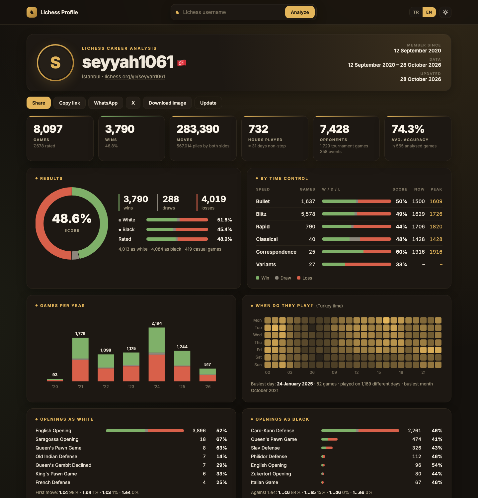
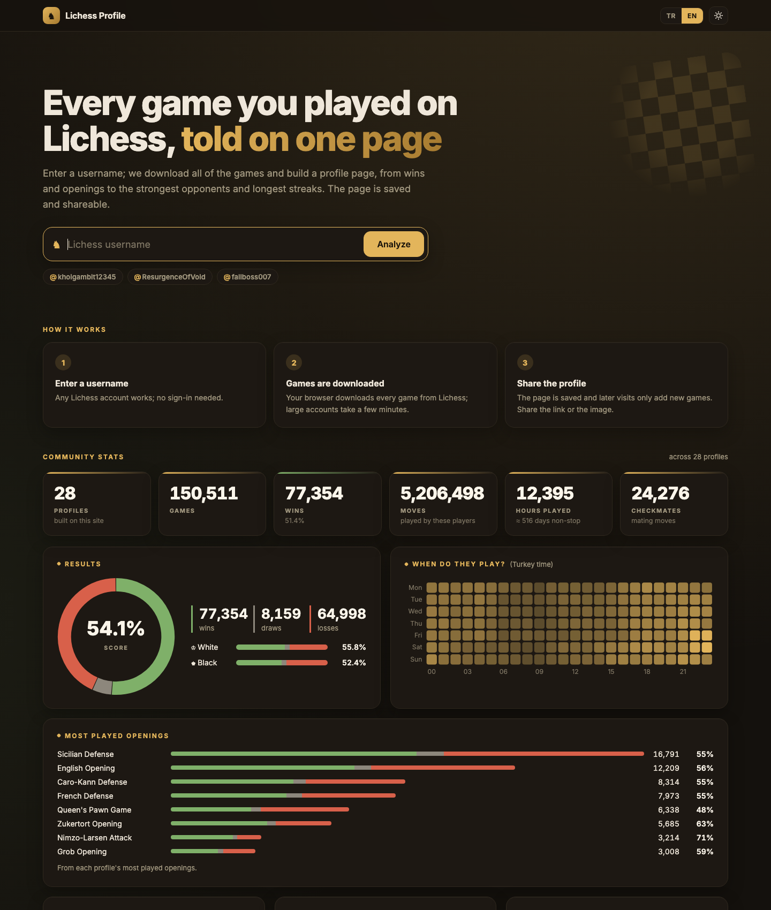

# ♞ Lichess Wrapped

**Your whole Lichess career on one page.** Enter a Lichess username and get a shareable stats page built from every game that player has played: results, time controls, openings, streaks, best wins, the hours they play most and more.

**Live:** [lichess.erhan.dev](https://lichess.erhan.dev) · **Example:** [lichess.erhan.dev/@/seyyah1061](https://lichess.erhan.dev/@/seyyah1061)

[](https://lichess.erhan.dev/@/seyyah1061)

## Features

- **Career stats from every game:** win/draw/loss record overall, with each colour and in each time control, with current and peak ratings.
- **Games per year** and a **day × hour heatmap** shown in the visitor's own time zone.
- **Openings** with each colour, first-move habits and replies to 1.e4 / 1.d4.
- **Move profile:** which pieces move most, captures, checks, mates, castling, promotions.
- **How games end**, **records** (longest streaks, longest game, fastest mate) and **opponents**: titled players faced, strongest players beaten, most frequent rivals.
- **Accuracy** stats when the games have computer analysis.
- **Sharing:** Web Share, copy link, WhatsApp, X, a full-page PNG download and a 1200×630 link preview card.
- **Community page:** totals, results, play times, popular openings and leaderboards across every profile built on the site.
- **Puzzles while you wait:** a large account takes a few minutes to download, so the loading screen has 1,000 puzzles from the Lichess puzzle database to solve on a board.
- **English and Turkish**, **dark and light** themes, works on phones.



## How it works

Everything runs on Cloudflare: a Worker with static assets and two SQLite-backed Durable Objects.

- **The visitor's browser downloads the games.** Lichess rate-limits the IP that all Cloudflare Workers share, even with an API token. So `public/app.js` streams the account and its games straight from the Lichess API (CORS is open), oldest first (`sort=dateAsc`, `since=<cursor>`), and posts them in batches of 300 to `/api/ingest`.
- **One `Profile` object per account** stores the games as JSON chunks. Each batch carries the current cursor; a mismatch returns 409, so two tabs can't interleave data. The server checks that the account matches, that the player is in every game, that ids are valid and that dates only move forward and aren't in the future. Stored games can't be changed; updates only append games after the cursor.
- **Resumable:** if the tab closes, the next visitor continues where it stopped. A profile older than 24 hours updates in the background on the next visit; the **Update** button works once an hour.
- **Stats are computed once** when an import finishes (`src/stats.ts`) and the page is rendered from that summary. The share card (`workers-og`) is rendered once per stats version and cached.
- **A `Registry` object** lists every profile with a small digest (`src/community.ts`) that the home page adds up into community stats and leaderboards.
- **SEO:** one URL per language (`?lang=tr|en`) with hreflang, `/sitemap.xml`, `robots.txt` and schema.org `ProfilePage` data.

> The server can't reach Lichess itself, so it can't prove the games really came from Lichess. A client doing the first import of an account could send made-up games that pass the checks.

### Routes

| Route | What it does |
| --- | --- |
| `/` | Search, community stats and recent profiles |
| `/@/:username` | Profile page; starts the import on the first visit and shows progress |
| `/og/:username.png` | 1200×630 share card |
| `/api/status/:username` | Import state (`importing`, `ready`, `missing`, `closed`) |
| `POST /api/ingest/:username` | Stores games the browser downloaded, in order |
| `POST /api/refresh/:username` | Opens an import for games since the last update (once an hour) |
| `/api/stats/:username.json` | Computed stats |
| `/sitemap.xml` | Home and every profile, in both languages |

## Development

```bash
npm install
npm run dev        # http://localhost:8787
npm test
npm run typecheck
npm run deploy
```

To check the stats against a real export (NDJSON from `/api/games/user/<name>`):

```bash
LICHESS_NDJSON=games.ndjson LICHESS_ID=yasinemrah npm test
```

The puzzle set is rebuilt from the Lichess puzzle database with `scripts/pick-puzzles.py` (usage in the script).

## Credits

- Game data from the [Lichess API](https://lichess.org/api). Not affiliated with Lichess.
- Puzzles from the [Lichess puzzle database](https://database.lichess.org/#puzzles) (CC0).
- Pieces: cburnett set by Colin M.L. Burnett (GPL/BSD/GFDL), as used by Lichess.
- Font: [Inter](https://rsms.me/inter/) (OFL).
